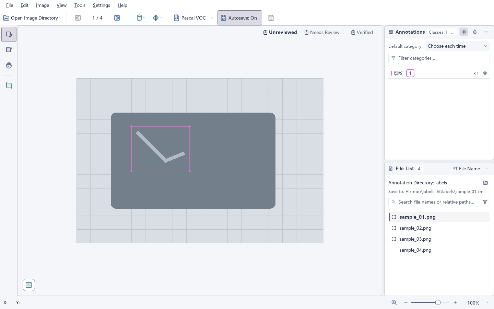
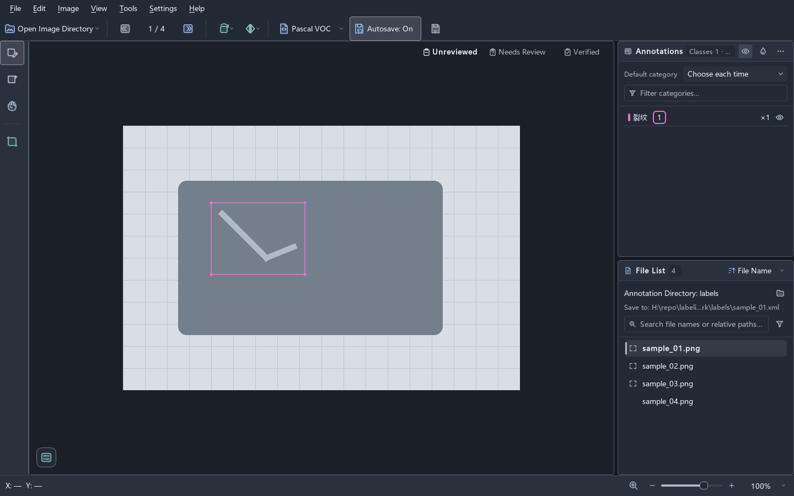

# LabelImg Enhanced

[简体中文](README.md) | [English](README.en.md)

An independently maintained bounding-box annotation tool derived from LabelImg `v1.8.6`. It retains the `LabelImg` application name and `labelImg` command while extending annotation, review, and image preparation. This is not an official HumanSignal project.

## Interface preview



<details>
<summary>View the dark theme</summary>



</details>

See the [development guide](docs/development.md#界面渲染与性能) for rendering tools and commands.

## Highlights

- Pascal VOC, YOLO, and CreateML reading/writing with an explicit save-format selector.
- Instant Simplified Chinese/English switching; Light, Dark, System, and eight accent presets, with saved preferences and cancel rollback.
- A single-image Canvas workbench with box/category multi-selection, deterministic overlap targeting, double-click label editing, and near-duplicate/category-conflict feedback.
- Filename/relative-path search, All/Any category matching, and annotation, review, persistence, and image-quality filters; Previous/Next follows the filtered results.
- Per-image Undo/Redo, autosave, external annotation synchronization and conflict handling, and recoverable file operations.
- Read-only annotation statistics and annotation-file cleanup under Tools; empty annotations are unchecked by default to preserve negative samples.
- Rotation, flipping, cropping, resizing, pixel adjustment, and colored-frame repair; separate non-destructive display adjustment, quality checks, and a drawing magnifier.

See the [documentation index](docs/README.md) for complete behavior and command locations.

## Requirements and installation

- Python 3.14 (`>=3.14,<3.15`); installation installs the runtime dependencies.
- Windows is the primary supported platform; Linux has headless CI coverage. There is no maintained macOS validation workflow.

Install and launch from the repository root:

```powershell
python -m pip install .
labelImg
```

You can also run `python -m labelimg`; use `python -m labelimg --help` for command-line arguments.

## Start annotating

1. Open an image directory, optionally choose a separate annotation directory, and confirm the save format.
2. Create boxes with the left tool rail and choose their categories; set `Unreviewed / Needs Review / Verified` at the Canvas's upper-right corner.
3. Search or filter the file list and continue with Previous/Next. Autosave starts enabled for each workspace and can be disabled under Settings; `Ctrl+S` saves manually.

The file panel shows the actual annotation save target, with its full path on hover. Existing documents update in place; new documents preserve relative subdirectories. A standalone image with no known mapping to a separate annotation directory requires a destination chosen with `Ctrl+S`; autosave pauses until then, and canceling preserves unsaved edits. Format conversion keeps the original file and requires explicit selection to overwrite an existing target. See the [save-target policy](docs/design/workspace-file-list.md#annotation-save-targets).

For split YOLO datasets, select `images` and `labels`, mapping `images/train/a.jpg` to `labels/train/a.txt`. Class resolution prefers annotation-local and `labels`-root `classes.txt`, then dataset-root `data.yaml`. Other locations inside the dataset require confirmation; outside configurations are excluded. Saving preserves existing IDs and appends new classes, updating the TXT and local/shared mappings transactionally. Conflicting IDs block saving; original YAML remains read-only. See [workspace rules](docs/design/workspace-file-list.md#workspace-and-current-image) for ambiguous paths, mapping approvals, and shared-vocabulary constraints.

## Updates

Automatic stable-release checks run asynchronously after launch, at most once every 24 hours. Disable them under Settings → Automatically Check for Updates, or check immediately under Help → Check for Updates. Python installations provide a copyable upgrade command, managed Windows installations offer explicit download/verification/installation, and portable builds open the release page. Installers are unsigned; SHA-256 verifies integrity only. See [Application Updates](docs/design/application-updates.md) for distribution actions, unsaved-work guards, and release builds.

## Development and validation

Read the [UI design guidelines](docs/design/ui-guidelines.md) before adding or changing an interface. Run the complete source suite with:

```powershell
python tools/run_tests.py
```

The runner selects repository source, offscreen Qt, and isolated test configuration automatically. Wheel builds, isolated validation, installed-package checks, focused tests, and rendering commands are maintained in the [development guide](docs/development.md). Building a wheel does not update an installed application.

## Origin and license

Derived from [HumanSignal/labelImg](https://github.com/HumanSignal/labelImg) `v1.8.6` (commit `1ab8241`). Project source is [MIT-licensed](LICENSE); see [NOTICE.md](NOTICE.md) for provenance and [THIRD_PARTY_NOTICES.md](THIRD_PARTY_NOTICES.md) for bundled Windows dependencies.
