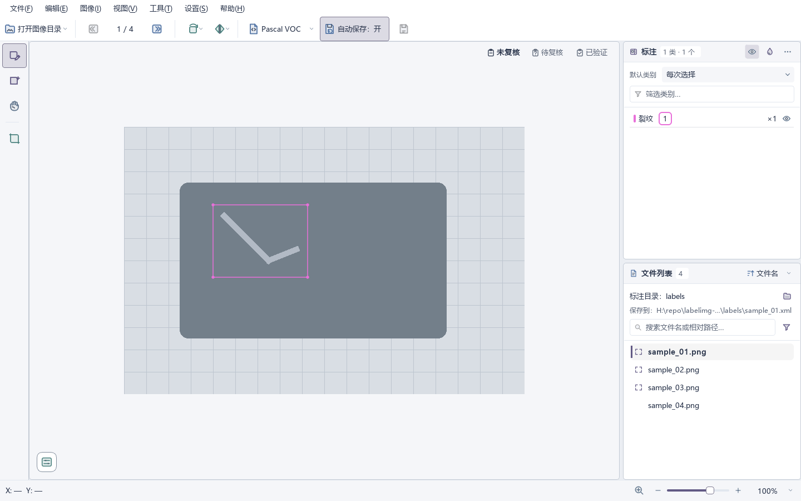
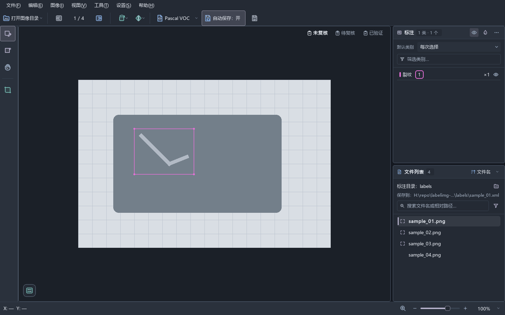

# LabelImg Enhanced

[简体中文](README.md) | [English](README.en.md)

基于 LabelImg `v1.8.6` 独立维护的目标框标注工具，保留 `LabelImg` 界面名称和 `labelImg` 启动命令，增强标注、复核与图像整理工作流。本项目并非 HumanSignal 官方项目。

## 界面预览



<details>
<summary>查看深色主题</summary>



</details>

渲染工具与命令见[开发指南](docs/development.md#界面渲染与性能)。

## 主要功能

- Pascal VOC、YOLO、CreateML 读写及明确的保存格式选择。
- 简体中文/英文即时切换；浅色、深色、系统跟随及八套强调色，设置可保存或取消回滚。
- 单图画布工作台：框与类别多选、确定性重叠目标选择、双击修改类别、近重复框与类别冲突提示。
- 文件名/相对路径搜索，类别全部/任一匹配，以及标注、复核、保存和图像质量筛选；上一张/下一张按筛选结果导航。
- 逐图撤销/重做、自动保存、外部标注同步与冲突处理，以及可恢复的文件操作。
- “工具”菜单提供只读标注统计与标注文件清理；空标注默认不选中，保留负样本。
- 图像旋转、翻转、裁剪、缩放、像素调整与彩色边框修复；另有不修改文件的显示调节、质量检查及绘制放大镜。

完整行为与操作入口见[文档导航](docs/README.md)。

## 环境与安装

- Python 3.14（`>=3.14,<3.15`），依赖由安装命令自动安装。
- Windows 为主要支持平台；Linux 通过无界面 CI 验证，macOS 尚无维护中的验证流程。

在仓库根目录安装并启动：

```powershell
python -m pip install .
labelImg
```

也可以使用 `python -m labelimg`，命令行参数见 `python -m labelimg --help`。

## 开始标注

1. 打开图像目录，按需选择独立标注目录，再确认保存格式。
2. 使用左侧工具创建框并选择类别；在画布右上角设置 `未复核 / 待复核 / 已验证`。
3. 在图片列表搜索或筛选，通过上一张/下一张继续。自动保存随工作区启用，也可在“设置”中关闭；`Ctrl+S` 手动保存。

文件面板显示当前标注的实际保存路径，完整路径见悬停提示。已有文档原位更新；新文档保留相对子目录。单独打开图像且无法确定与独立标注目录的映射时，先用 `Ctrl+S` 选择目标；选定前自动保存暂停，取消会保留未保存编辑。格式转换保留原文件，覆盖已有目标需要明确选择。详见[保存目标规则](docs/design/workspace-file-list.md#annotation-save-targets)。

YOLO 分目录数据集可分别选择 `images` 和 `labels`，例如 `images/train/a.jpg` 对应 `labels/train/a.txt`。类别映射优先读取标注同目录和 `labels` 根目录的 `classes.txt`，再读取数据集根目录 `data.yaml`；其他数据集内位置需要确认，不读取数据集外配置。保存保留已有类别编号并追加新类别，同时事务性更新 TXT、本地和共享类别表；编号冲突会阻止保存，原有 YAML 保持只读。路径歧义、配置确认及共享类别表约束见[工作区规则](docs/design/workspace-file-list.md#workspace-and-current-image)。

## 更新

默认启动后异步检查最新稳定版，最多每 24 小时一次；可在“设置 → 自动检查更新”关闭，或从“帮助 → 检查更新…”立即检查。Python 安装提供可复制的升级命令，托管 Windows 安装提供主动下载、校验和安装，便携版打开发布页。安装包未签名，SHA-256 校验只验证完整性。更新方式、未保存内容检查与发布流程见[应用更新](docs/design/application-updates.md)。

## 开发与验证

新增或修改界面前先阅读 [UI 设计规范](docs/design/ui-guidelines.md)。源码全量验证入口：

```powershell
python tools/run_tests.py
```

运行器自动选择仓库源码、无界面 Qt 和隔离测试配置。构建 wheel、隔离验证、安装包验证、定向测试和渲染命令统一见[开发指南](docs/development.md)；构建 wheel 本身不会更新已安装程序。

## 来源与许可证

派生自 [HumanSignal/labelImg](https://github.com/HumanSignal/labelImg) `v1.8.6`（commit `1ab8241`）。项目源码采用 [MIT 许可证](LICENSE)，来源见 [NOTICE.md](NOTICE.md)；Windows 捆绑依赖的声明见 [THIRD_PARTY_NOTICES.md](THIRD_PARTY_NOTICES.md)。
